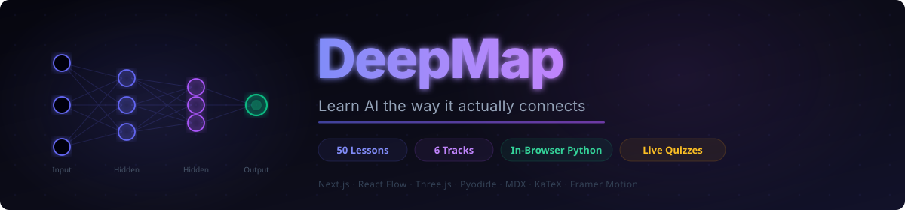

<div align="center">



<br/>

[](https://nextjs.org)
[](https://typescriptlang.org)
[](https://pyodide.org)
[](https://reactflow.dev)
[](LICENSE)

**50 interactive lessons · 6 tracks · in-browser Python · zero sign-up**

[**→ Open the app**](https://learn.naveenkumarbaskaran.com) · [Report a bug](https://github.com/naveenkumarbaskaran/deepmap/issues) · [Add a lesson](#contributing)

</div>

---

## What is DeepMap?

DeepMap is a self-contained AI/ML learning platform where **the curriculum is a knowledge graph, not a list**. Every concept is a node. Every prerequisite is an edge. You navigate by clicking, not scrolling through a syllabus.

No sign-up. No backend. No cloud dependency. It runs entirely in your browser.

```
click a node  →  lesson slides in  →  run the Python  →  answer the quiz  →  next lesson unlocks
```

<br/>

## Tracks

```
📐 Mathematics          🧠 Neural Networks      🔬 Deep Learning
   Linear Algebra          Perceptron & MLP        CNNs
   Calculus                Activation Functions    RNNs & LSTMs
   Probability             Backpropagation         Seq2Seq
   Statistics              Optimizers              Attention Mechanisms
   Information Theory      Loss Functions          Transfer Learning
   Matrix Calculus         Regularization          Batch Normalization
   Optimization Theory     Weight Initialization   Residual Networks
   Bayesian Inference      Universal Approximation Object Detection · Image Segmentation
                                                   Generative Models

⚡ Transformers         💡 LLMs & Gen AI        🕵️ Agents
   Self-Attention          Prompting               ReAct & Tool Use
   Multi-Head Attention    In-Context Learning     Multi-Agent Systems
   Positional Encoding     Fine-Tuning (SFT)       Memory & Context
   Transformer Architecture RLHF & DPO            MCP & A2A
   BERT · GPT Architecture RAG · Scaling Laws      Agentic RAG
   Efficient Transformers  Diffusion Models        Agent Evaluation
   Vision Transformers     VAEs · GANs · Multimodal
```

> Track order matters — **Mathematics** unlocks **Neural Networks**, which unlocks **Deep Learning**, and so on down the chain.

<br/>

## Features

| Feature | Detail |
|---|---|
| **Knowledge Graph** | React Flow canvas — 50 nodes, 6 colour-coded tracks, zoom/pan, minimap |
| **In-Browser Python** | Pyodide WASM runtime — `numpy`, `pandas`, `scipy` auto-load on first run, no install |
| **Interactive Quizzes** | Per-lesson multiple choice with instant feedback and explanations |
| **Progress Tracking** | localStorage — survives page refresh, no account needed |
| **Track Unlocking** | Sequential — completing a track unlocks the next one |
| **Dark / Light Mode** | Full CSS-variable theming with a header toggle |
| **MDX Lessons** | KaTeX math, SVG diagrams, editable code, prose — all in one file |
| **3D Hero** | Three.js animated neural network on the landing page |

<br/>

## Getting Started

```bash
git clone https://github.com/naveenkumarbaskaran/deepmap.git
cd deepmap
npm install
npm run dev
# → http://localhost:3000
```

No environment variables. No database. No external API key.

<br/>

## Project Structure

```
deepmap/
├── app/
│   ├── page.tsx                   Landing page — Three.js hero + track overview
│   ├── learn/page.tsx             Knowledge graph + lesson panel
│   └── api/lesson/[slug]/         Server-side MDX compilation
│       └── route.ts               serialize() + remark-math + rehype-katex
│
├── components/
│   ├── graph/
│   │   ├── KnowledgeGraph.tsx     React Flow canvas, 50 nodes, edges
│   │   └── GraphNode.tsx          Node card — locked / available / complete states
│   ├── lesson/
│   │   ├── LessonPanel.tsx        Slide-in panel — MDX renderer + footer nav
│   │   ├── LessonContent.tsx      MDXRemote with custom component map
│   │   └── LessonProgress.tsx     Track + lesson position badge
│   ├── interactive/
│   │   ├── CodeRunner.tsx         Pyodide executor — textarea + output pane
│   │   ├── Quiz.tsx               Multiple choice — select → check → explain → next
│   │   └── diagrams/              NeuronDiagram, BackpropDiagram, AttentionHeatmap…
│   └── ui/
│       └── ThemeToggle.tsx        Dark / light switcher
│
├── content/
│   └── <track>/<slug>.mdx         50 lesson files
│
└── lib/
    ├── graph-data.ts              50 nodes, edges, track colours, TRACK_ORDER
    ├── mdx.ts                     File reader + frontmatter parser
    ├── mdx-components.tsx         pre → CodeRunner / Quiz interceptor
    └── progress.ts                useProgress hook — localStorage state
```

<br/>

## Key Dependencies

| Package | Purpose |
|---|---|
| `@xyflow/react` | Knowledge graph canvas |
| `@react-three/fiber` + `drei` | 3D animated neural network hero |
| `next-mdx-remote` | Server-side MDX → React |
| `pyodide` | CPython in WebAssembly |
| `remark-math` + `rehype-katex` | LaTeX math rendering |
| `framer-motion` | Panel slide-in, node pulse animations |

<br/>

## How a Lesson File Works

Every lesson is a single `.mdx` file with four sections:

````md
---
title: "Linear Algebra"
track: "mathematics"
estimatedMinutes: 12
description: "Vectors, matrices, and the foundations of everything in ML"
---

## Vectors

A vector is an ordered list of numbers. The dot product $\mathbf{a} \cdot \mathbf{b} = \sum_i a_i b_i$
measures alignment. Cosine similarity $\cos(\theta) = \frac{\mathbf{a} \cdot \mathbf{b}}{||\mathbf{a}||||\mathbf{b}||}$ is used everywhere in NLP.

<NeuronDiagram animate />

```python runnable
import numpy as np
a = np.array([1, 2, 3])
b = np.array([4, 5, 6])
print("Dot product:", np.dot(a, b))
print("Cosine similarity:", np.dot(a, b) / (np.linalg.norm(a) * np.linalg.norm(b)))
```

```quiz
[{
  question: "What does the dot product measure?",
  options: ["Length", "Alignment", "Direction", "Rank"],
  correct: 1,
  explanation: "The dot product is maximised when vectors point in the same direction."
}]
```
````

The custom `pre` component in `lib/mdx-components.tsx` intercepts ` ```python ` fences → `<CodeRunner>` and ` ```quiz ` fences → `<Quiz>`. No special syntax, no prop serialization issues.

<br/>

## Architecture Notes

**Server-side MDX compilation** — `serialize()` runs in the API route, not the client. Client-side serialization drops JavaScript expressions in JSX props (arrays, template literals). Moving it server-side solved the `questions={[...]}` and `code={\`...\`}` serialization problem entirely.

**Turbopack + Pyodide CDN** — Turbopack intercepts `import()` and tries to bundle at build time. CDN URLs can't be bundled. The fix: `new Function('url', 'return import(url)')("https://cdn.jsdelivr.net/pyodide/...")` runs outside Turbopack's module resolver, letting the browser fetch Pyodide at runtime.

**Shallow URL updates** — `/learn/linear-algebra` is a URL state, not a page. There's no `app/learn/[slug]/page.tsx`. Using `window.history.replaceState` instead of `router.push` updates the address bar without triggering Next.js navigation to a 404.

<br/>

## Deployment

```
1.  vercel.com/new  →  import naveenkumarbaskaran/deepmap
2.  Framework: Next.js (auto-detected), no env vars
3.  Project Settings → Domains → add learn.naveenkumarbaskaran.com
4.  DNS: CNAME  learn  →  cname.vercel-dns.com
```

<br/>

## Contributing

To add or improve a lesson:

1. Create `content/<track>/<slug>.mdx` with frontmatter (`title`, `track`, `estimatedMinutes`, `description`)
2. Add a node entry in `lib/graph-data.ts` — `id`, `slug`, `label`, `track`, `position`, `estimatedMinutes`
3. Add prerequisite edges in the `EDGES` array in `lib/graph-data.ts`
4. `npm run dev` → click the node → test it

Use `$...$` for inline math and `$$...$$` for display math. Add a ` ```python runnable ` block and a ` ```quiz ` block at the end.

<br/>

## License

MIT © [Naveen Kumar Baskaran](https://github.com/naveenkumarbaskaran)
